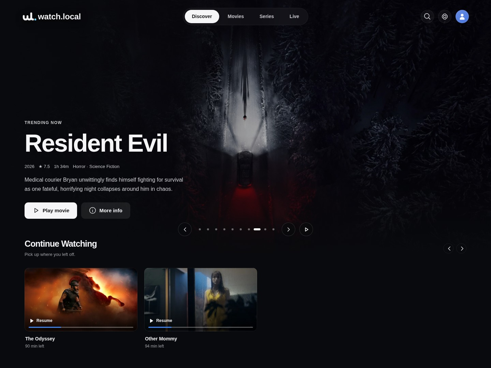
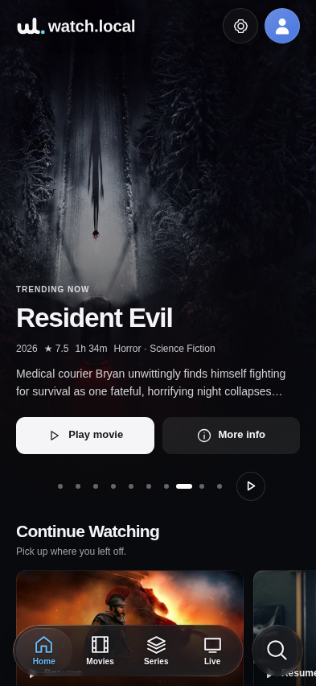
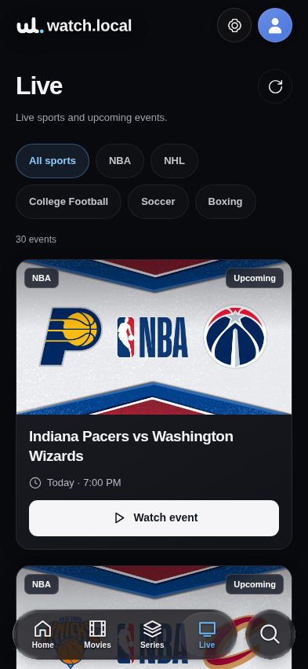
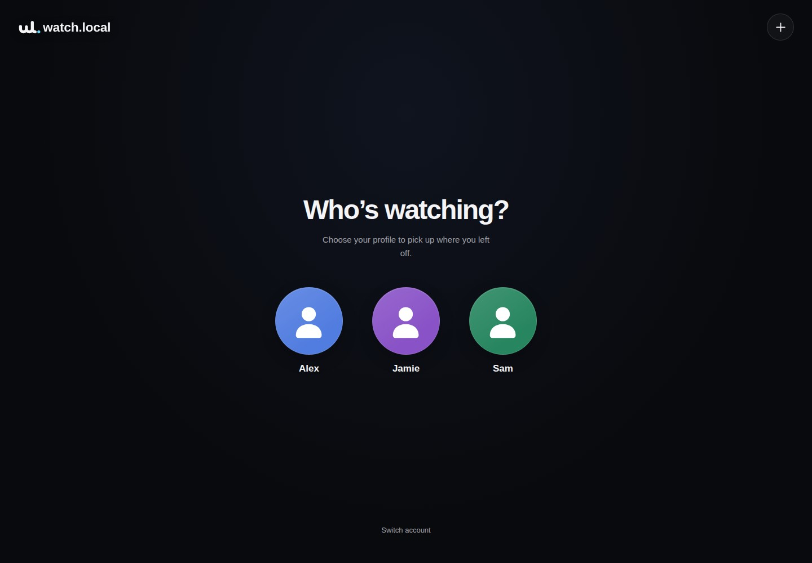
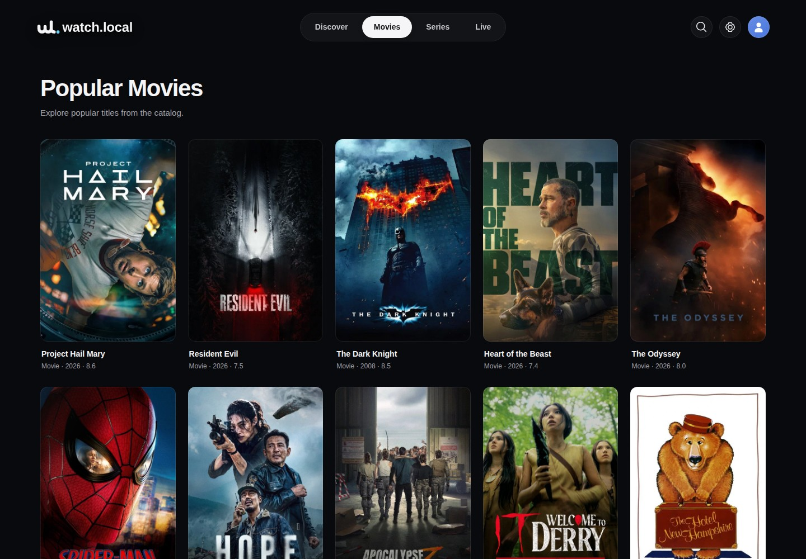

<div align="center">


**A streaming app for your home network.**

Movies, series, and live sports through an Xtream-compatible API and M3U playlists.


[Quick start](#quick-start) · [Web interface](#web-interface) · [Connect your player](#connect-your-player) · [How it works](#how-it-works) · [API reference](IPTV.md)

</div>

---

## Overview

watch.local runs on your computer and exposes external web-player streams to IPTV
apps on your local network. One Node.js process handles the catalog, playback
resolution, and HLS relay. A cinematic web interface lets you browse, watch, and
manage the server. The terminal dashboard keeps connection details visible above
a live request log.

| Feature | What you get |
| --- | --- |
| **Player compatibility** | Xtream-compatible login and M3U playlists |
| **Movies and series** | Upstream listings, artwork, seasons, and episode details; optional TMDB fallback |
| **Live sports** | Scheduled events, a sports-only playlist, and an XMLTV guide |
| **Provider fallback** | Cinejoy, Atlantic, Tvids, Zstream, Vidrift, and VidSrc |
| **HLS playback** | Local stream relay, highest advertised video quality, and supported subtitles |
| **Terminal dashboard** | Fixed connection panel with incoming requests and server activity below |
| **Web interface** | Full-screen artwork, animated cards, search, title pages, episodes, and browser playback |
| **Local discovery** | Open `watch.local` on a compatible LAN, with no router setup |
| **Viewer profiles** | Remember who’s watching, with separate progress for each profile |
| **Continue Watching** | Server-saved movie and episode progress, with resume across browsers and devices |
| **Provider settings** | Reorder or disable sources, set time budgets, and choose adaptive or highest quality |
| **Multiple accounts** | Administrator and viewer roles, separate IPTV links, account expiry, and access controls |

> **Availability:** Catalog entries and scheduled events do not guarantee a
> playable stream. Playback depends on external sources and your internet
> connection. Keep the host computer running while you use the service.

## Quick start

### Requirements

- **Node.js 24 or newer**, with npm
- Internet access for metadata and streams
- An IPTV player that supports Xtream Codes or M3U

### Install and run

Clone the public repository:

```sh
git clone https://github.com/JackHars/watch.local.git
cd watch.local
npm ci
npm start
```

On first launch, choose a **username** and **password**, then confirm the
password. Password entry is hidden. This becomes the **owner administrator** for
both the website and IPTV apps. There are **no default credentials**.

The catalog uses upstream providers automatically. **No TMDB account or API key
is required.** To add TMDB as a backup source, save your own credential and enable
its fallback in **Settings → Metadata**. Existing saved credentials are retained;
the new fallback setting starts disabled.

On later interactive launches, press **Enter** to keep a saved value or enter a
replacement. If you change your login, update it in your IPTV apps too. To run
without an interactive terminal, complete the first setup in a terminal; later
starts reuse the saved credentials.

## Web interface

Open the **Web interface** address printed in the terminal, or
`http://localhost:8091` on the host computer. Use the server’s LAN address on
another device. By default, direct LAN visitors open the web panel as the owner
without signing in. Enable **Settings → General → Require login on LAN** to
require an account. Remote and forwarded requests always require a login; IPTV
apps always use their own credentials.

Router-managed local DNS names such as `watch.lan` work with the same LAN access
setting, alongside LAN IP addresses, single-label hostnames, `.local`, and
`.localdomain` names. Requests must still come directly from a private network;
forwarded requests and unrelated public hostnames require a login.

**Settings → General → Web interface on port 80** optionally separates the two
services. It is **off by default**. Enable it and restart watch.local to open the
website at `http://server` or `http://<LAN address>` while IPTV keeps its configured
port (8091 by default). The old web address redirects to the new one. Xtream,
M3U, and XMLTV links continue to use the IPTV port; browser playback uses signed
media links on the web port. Turning the option off and restarting restores the
shared port.

### Local discovery: watch.local

Local discovery is **on by default**, including when upgrading an existing
installation. On a normal home network, watch.local advertises `watch.local` using
mDNS/Bonjour without changing router DNS settings. Open `http://watch.local`
when the port 80 option is enabled, or `http://watch.local:8091` with the default
shared port. Discovery always advertises the actual running web port, including
the fallback port if port 80 cannot open. IPTV still uses its own port.

In **Settings → General → Local discovery**, turn discovery off or choose a
different **Local name**. These changes apply without restarting. The settings
page and terminal report the address actually announced. If the name is already
taken, the responder chooses a numbered name and the displayed address updates.
The server withdraws its announcement when disabled or shut down and refreshes
it as LAN interfaces change. Discovery errors leave access by IP available.

Devices must support mDNS and be able to exchange local multicast traffic
(UDP 5353). Guest Wi-Fi isolation, host firewalls, and separate VLANs may block
discovery. A loopback-only listener is not advertised. Router-managed names such
as `watch.lan` continue to work independently.

**Linux Docker:** bridge networking does not carry LAN multicast. Use the
discovery companion in [compose.example.yaml](compose.example.yaml), which runs
on the host network while the web/IPTV app keeps its bridge network. After the
initial account setup and `npm ci`, create `data/discovery` as the same user who
runs the containers (`mkdir -p data/discovery`) and run
`docker compose -f compose.example.yaml up -d`. Match the example's user ID to
the owner of the data directory. Enable the port 80 option separately if wanted.
Keep published web/IPTV ports equal to their configured ports; update
`WATCHLOCAL_DISCOVERY_ENDPOINT` if changing the IPTV port. The companion reads only
the local health endpoint and shares a status file, without access to account or
TMDB settings. It withdraws discovery if the app stops responding.

For a native install, discovery runs inside `npm start`. A Linux container
already using host networking can explicitly select `WATCHLOCAL_MDNS_MODE=builtin`
instead of using the companion; it must be able to bind the configured HTTP
ports. Unconfigured containers report discovery as unavailable rather than
advertising an unreachable container address. Docker Desktop networking differs;
use a native LAN responder when multicast cannot reach the physical network.

Port 80 must be available and the process must have permission to bind it. For a
Docker deployment, publish both `80:80` and the IPTV port, such as `8091:8091`.
If the port 80 listener cannot start, watch.local keeps the web panel on the IPTV
port and shows the reason in General settings and the server log. The toggle
remains saved for the next restart.

On phones, use the floating glass dock to browse and its separate Search button
to find titles. Swipe through title rows and open settings from the transparent
top bar, which hides on downward scroll and returns when you scroll up. The layout accounts for notches and the home
indicator. Add the page to your Home Screen for a standalone window on supported
browsers; playback and browsing still need a connection to the server.

### Automatic updates

**Settings → Updates** can automatically install new commits from the
repository's `main` branch. It is **off by default**. The default check interval
is five minutes; **Check now** queues a check within a minute. With automatic
updates off, a manual check reports available updates without installing them.

Install the host service once on Linux, as the user who owns the checkout and
can run Docker Compose:

```sh
node scripts/install-updater.mjs --compose /absolute/path/compose.yaml --data /absolute/path/data
sudo loginctl enable-linger "$USER"
```

The Compose services default to `watchlocal,discovery`; use `--services` to
specify different names. A native installation running as a **user systemd
service** can use `--service watchlocal.service` instead of `--compose` and needs
Node 24 or later. Docker hosts need Node 22 or later, Git, `flock`, systemd and
Docker Compose; candidate dependencies are installed using the app's Node image.
The installer prints whether lingering still needs to be enabled. It keeps the
timer running after logout and at boot. Then turn on **Automatic updates** in
Settings. No GitHub credential or inbound webhook is required for a public repo.

The host agent only follows the configured GitHub `origin` and fast-forwards
`main`. It waits for the exact commit's `checks.yml` push workflow to succeed,
prepares dependencies and checks syntax in a separate checkout, then briefly
restarts the app. Local changes, divergent history, failed checks and network
errors leave the installed version in place. Both web and IPTV health endpoints
are checked; override their local addresses with `--health-urls` if your runtime
ports differ from saved settings.

Private data and the previous dependencies are backed up outside the repository
before installation. If startup fails, code, dependencies and data are restored;
the failed commit is skipped until a newer one arrives. An interrupted update
is recovered on the next timer run. The web app exchanges status and check
requests through private files and never receives a Docker socket or shell access.

The agent runs as `watchlocal-update.timer` / `watchlocal-update.service` under
your user account. To inspect it:

```sh
systemctl --user status watchlocal-update.timer
journalctl --user -u watchlocal-update.service -n 50
```

Its host configuration, recovery runner and latest rollback backup live in
`~/.local/state/watchlocal-updater` by default (`--state` chooses another location
outside the checkout and data directory). Treat `backup/data` as private: it
contains the same account and metadata credentials as your live data. Only one
rollback snapshot is retained; it is replaced at the next installation.

If Settings reports that recovery could not finish, preserve the state directory
and resolve the host service, disk-space or local-checkout issue before starting
`watchlocal-update.service` again. The saved transaction is recovered before any
new update is attempted. A commit that was rolled back is not retried by
**Check now**; publish a corrected commit to `main` instead. To uninstall the
schedule, run `systemctl --user disable --now watchlocal-update.timer`.

### Screenshots

<p align="center">
  <a href="docs/screenshots/home-desktop.jpg"></a>
</p>
<table>
  <tr>
    <td width="50%" align="center"><br>Home on mobile</td>
    <td width="50%" align="center"><br>Live on mobile</td>
  </tr>
</table>
<details>
  <summary>Profiles and movie browsing</summary>
  <p></p>
  <p></p>
</details>

Captured from the running app with sample profiles. Artwork and listings vary
with the connected sources. [View the ten logo concepts](docs/branding/concepts.png). The app uses concept 05, the WL monogram.


- **Who's watching?:** Choose a profile the first time you open the website.
  Your browser remembers that choice across refreshes and future visits, with a
  separate preference for each account. Signing out or choosing to switch
  profiles clears the remembered choice.
  Use the **+** in the top-right corner to add a name and colour. Each profile
  appears as a coloured person icon with its name underneath. Switch profiles
  with the person icon in the main navigation. Profiles do not need passwords;
  account login requirements still follow your LAN access setting.
- **Discover, Movies, and Series:** Browse artwork, search titles, inspect details,
  choose a season and episode, and play in the browser. Save titles to **My List**
  for the selected profile on the current browser.
- **Trending carousel:** Up to ten trending movies and shows rotate every five
  seconds. Swipe, use the dots or arrows, or pause the slideshow. Rotation pauses
  during playback, while the carousel is off-screen, and when interacting with
  its controls. Reduced-motion users can start rotation explicitly.
- **Home categories:** Browse **New Release Movies**, **Trending Shows**,
  **Trending Movies**, **On TV This Week**, **Top-Rated Movies**, and
  **Top-Rated Shows**. Each **See all** link opens that category and keeps its
  selection when loading more titles. Trending uses daily trend data; new
  release movies use the current theatrical-release feed, and the TV week row
  includes shows airing in the next seven days.
- **Top-Rated selection:** These two web rows focus on released, live-action,
  English-language titles rated at least 7/10, with at least 1,000 movie votes or
  500 show votes. The server gathers six top-rated pages and three popular pages
  per type, removes duplicates, and ranks the whole pool before pagination.
  Ratings are weighted toward a 7/10 prior equivalent to 3,000 movie votes or
  1,500 show votes, reducing the influence of small fan samples. A capped logarithmic
  popularity bonus adds at most 0.35 points. Rankings are cached for an hour;
  incomplete refreshes preserve the last complete selection. Displayed ratings
  remain the source's original scores. This is an English-language discovery
  preference, not regional audience-rating data; search and the full IPTV
  catalog retain animation and international titles.
- **Continue Watching:** Unfinished movies and episodes appear as the first home
  category, above **My List** and the discovery categories. Select a card to resume its saved position,
  or choose **Start over** in the player. Progress is saved on the server per
  profile and survives restarts. Profiles belong to an account; LAN visitors
  without a login can choose from the owner's profiles, each with separate
  history. Finished titles leave the row. This tracks the built-in web player;
  external IPTV apps manage their own playback history.
- **Live:** Browse artwork cards for live and upcoming sports, filter by sport,
  and see event times in your local timezone. Phones use full-width cards with
  large watch buttons; larger screens show a grid. Event artwork loads lazily
  from the sports sources, with a themed matchup card when an image is missing
  or unavailable. Playback availability is checked when you open an event.
- **Settings → IPTV connections:** Copy Xtream credentials, M3U playlists, and the
  XMLTV guide. Administrators can select any account; viewers see their own.
- **Settings → Metadata:** Keep upstream providers as the default, optionally
  enable TMDB fallback, and verify, replace, or remove your TMDB credential. Only
  administrators can change these settings; saved credentials are never returned
  to the browser.
- **Settings → Providers:** Drag providers into fallback order or use the arrow
  buttons. Enable sources individually, adjust timeouts and caching, and choose
  highest available or adaptive video quality.
- **Settings → Users:** Create, edit, disable, expire, or delete users. Viewers can
  watch and manage their own login. Administrators also manage server settings
  and other users. The owner remains an active administrator.
- **Settings → General, Library, and Activity:** Set the server name and connection
  address, manage catalog imports, and inspect recent requests.

Most settings apply to new requests immediately. Listen address, IPTV port, and
the port 80 option require a restart. Changing an account or disabling it invalidates its old browser
sessions and signed media links; update saved credentials in its IPTV apps.
Browser sessions also end when the server restarts.

The web player uses locally served **hls.js**, or native HLS where supported.
Codec support depends on the browser; an IPTV app may support formats that your
browser cannot play. Keyboard focus and reduced-motion preferences are supported.

### Terminal dashboard

Once the server starts, the fixed connection panel displays:

- Web interface and Xtream server addresses, username, and password
- Full M3U playlist and sports-only playlist URLs
- XMLTV guide URL and stream format

Incoming requests and server activity appear below the panel. Request logs omit
credentials and signed media tokens. Keep the terminal open while using the
server, and press **Ctrl+C** to stop it. Owner login changes made on the website
also update the terminal’s connection panel.

## Connect your player

### Xtream Codes

1. Start watch.local and open your IPTV app.
2. Add a provider using **Xtream Codes**, **Xtream API**, or **username/password login**.
3. Copy the connection details from **Settings → IPTV connections** or the terminal:

| Player field | Value |
| --- | --- |
| **Server / portal URL** | The **IPTV server** address, for example `http://192.168.1.100:8091` |
| **Username** | The selected account’s username |
| **Password** | The selected account’s password |
| **Stream format** | **HLS / m3u8**, if requested |

4. Save the provider and open **Movies**, **Series**, or **Live TV**.

### M3U and TV guide

Copy the terminal's **M3U playlist** URL into your player's M3U URL field. For an
EPG or TV guide, use the **XMLTV guide** URL. Use the **sports-only playlist** URL
if you only want live events.

Refresh the provider or playlist after changing the catalog. See the
[IPTV connection and API reference](IPTV.md) for endpoints, playlist options,
and catalog management.

## How it works

```text
IPTV player on your LAN
        |
        | Xtream API / M3U / XMLTV
        v
watch.local on your computer
        |
        +-- Upstream catalog ------> Movie and series metadata
        +-- TMDB (optional) -------> Metadata fallback
        +-- Six playback providers -> Movie and episode HLS sources
        +-- Sports event pages ----> Schedules and published HLS sources
        |
        +-- Local HLS relay -------> Playlists, segments, keys, and subtitles
```

### 1. Build the catalog

**Trending** comes directly from the public **Today** panel on
[TMDB's homepage](https://www.themoviedb.org/), without an account, API key, or
catalog proxy. The panel contains up to 20 mixed movie and TV titles in their
published order. Home filters that list into its movie and show rows and uses
up to ten titles with backdrop art for the rotating hero. The public panel has
one page; it is not a substitute for the authenticated API's full paginated
rankings. Parsed lists are validated, shared between requests, cached for 15
minutes, and retained for up to seven days during temporary outages. Website
markup can change, so an unreadable panel keeps the last successful list.

Other catalog requests try **7Movies / Vidrift**, then the alternate
7Movies domain. **Atlantic is not used for catalog metadata.** These endpoints provide
popular and highly rated lists, search results, title details, credits, artwork,
and seasons. The server normalizes their responses for the web UI and Xtream,
keeps existing title and episode IDs, and caches metadata locally. Catalog imports
use release-year filters to expand beyond the main lists. New installations get
a starter catalog first, then expand it in the background at a paced request
rate. Web browsing and existing IPTV listings remain available during imports.

**TMDB is an optional fallback**, disabled by default. Enable it in
**Settings → Metadata** after saving your own API key or Read Access Token. It is
used when upstream information is missing or unavailable. Credentials are checked
with TMDB when you save them; no shared credential is bundled. Without a fallback,
cached information remains usable during temporary outages where available.

These upstream endpoints serve TMDB-derived information, and artwork still
loads from its image CDN. No personal API credential is required for upstream
metadata, but TMDB IDs and images are still used. Sports schedules use a separate adapter and do not
require a TMDB credential. Catalog entries describe titles, not confirmed video
availability.

### 2. Resolve playback on demand

When you play a movie or episode, watch.local tries these providers in order and
uses the first source that passes its HLS and video-segment checks. This is the
default order; change it in **Settings → Providers**:

| Order | Provider | How playback is resolved |
| --- | --- | --- |
| 1 | **Cinejoy** | Sends the TMDB ID through `api.wing.st` using the bundled `crush.wasm` lumen-gate encoder, then decrypts the reply and tries its video mirrors. |
| 2 | **Atlantic** | Tries Athena, Aphrodite, and Moscow; Moscow's encrypted source URL is decoded with AES-GCM. |
| 3 | **Tvids / Xpass** | Reads the embed's data URL, derives its AES-GCM key, decrypts the backup list, and checks the returned playlists. |
| 4 | **Zstream** | Calls the shared Cinecat / P-Stream scraper and selects a working HLS source with its supplied playback headers. |
| 5 | **Vidrift** | Gets a playback token from the 7movies family, loads Vidrift's boot response, and tries its Bigbang and Vexon HLS sources. |
| 6 | **VidSrc** | Looks up the IMDb ID through the metadata layer, follows the gate/player chain, extracts rotating key tables from the supplied WASM, decrypts the URL list with ChaCha20, and obtains a media-host token. |

Series requests include season and episode numbers. Failed providers are skipped;
successful resolutions are cached for five minutes by default. Default attempts
have a 30-second budget per provider and a 180-second overall budget. These values
are configurable in the web settings. Availability varies
by title and provider. Direct MP4-only results are skipped because this server
serves HLS to IPTV players.

All six adapters run inside the existing Node.js process. The new adapters were
ported from Red Hermes' October 25, 2026 research using Node's built-in crypto.

VidSrc needs an IMDb ID. Upstream movie details normally include one; missing
mappings are read from the title's public TMDB structured data without an API key.
A missing mapping makes VidSrc fail
for that title, allowing the other enabled playback providers to be tried.

### 3. Reproduce each web player's requests

Each provider supplies its own browser-style **User-Agent**, **Origin**, and
**Referer**. watch.local retains these headers when checking a source and when
relaying its playlists, video segments, encryption keys, and alternate tracks.
Cinejoy, for example, uses the `cinejoy.pk` Origin and Referer. This reproduces
the web player's request headers; it does not grant access to an unpublished
stream.

The resolver checks the highest advertised video rendition and samples its first
segment before accepting it. HTML error pages and image-based placeholder feeds
are rejected so another source or provider can be tried. The terminal log shows
which provider was selected.

### 4. Relay the stream to your player

watch.local fetches the HLS playlist, selects the highest advertised video quality
(or retains all variants in adaptive mode), and rewrites remote playlist, segment,
and key URLs as **signed local URLs** tied to the requesting user.
Your IPTV app requests those local URLs; watch.local forwards the requests with the
required headers and streams the returned bytes back. Supported subtitle tracks
can also be attached. Videos are not saved as a local library.

### 5. Resolve sports feeds separately

The sports adapter follows published iframe or player links from event pages to
find an HLS feed. It relays that feed using the source page's `Referer`, `Origin`,
and browser-style User-Agent. A scheduled event remains unplayable until its
source publishes a supported HLS link. The repository contains no permanent TV
channels or video library.

## Configuration

Use **Settings** in the web interface for saved server, provider, catalog, and
account configuration. Environment variables override the saved listen address
and port:

| Setting | Default | Purpose |
| --- | --- | --- |
| `HOST` | `0.0.0.0` | Network interface to listen on |
| `PORT` | `8091` | IPTV port; also serves the website when the port 80 option is off |

For access only from the host computer:

```sh
HOST=127.0.0.1 npm start
```

To use another port:

```sh
PORT=8092 npm start
```

watch.local is intended for a **trusted local network** and is not configured for
public access. If a firewall is enabled, allow the configured port on your
trusted LAN. Other devices must be able to reach the host computer.

### Saved data

The server creates `data/` on first launch. It holds accounts, server settings,
signing secret, catalog, and metadata caches. Accounts and settings are saved in
`data/iptv.json`; passwords are stored there so IPTV connection links can be
shown and copied. An optional TMDB credential is stored in the same private file,
separately from playback providers, and is sent only to TMDB. The directory is
excluded from Git. Keep it private and back it up.

Existing single-account installations migrate automatically. The existing login
becomes the owner, and `data/iptv.pre-users.json` keeps a one-time backup of the
original account file. Existing catalogs and pinned titles are retained.

Profiles and playback positions are saved in `data/watch-progress.json`. Older
account-wide watch history moves into a **Main** profile automatically, with the
original history kept in `data/watch-progress.pre-profiles.json`. Back up these
files along with the rest of `data/` to preserve everyone's place.

`data/`, `config.json`, and environment files are excluded from Git. Additional
catalog settings and cache details are documented in [IPTV.md](IPTV.md#local-data-and-configuration).

## Verification

Check the source syntax:

```sh
npm run check
```

With the server running, check its health:

```sh
curl http://localhost:8091/health
```

Test provider resolution, fallback, encryption, and the local media relay:

```sh
npm run test:providers
npm run test:web
npm run test:metadata
```

For the available test commands and API checks, see [IPTV.md](IPTV.md#checks).

## Configuration and upgrades

Credentials belong in private runtime settings, never in source code. TMDB is
optional and ships without a key; enter your own in **Settings → Metadata**.
The default `data/` directory, `.env` files, runtime configuration, and backups
are ignored by Git. CI scans every commit for secrets and rejects tracked
private configuration files.

`WATCHLOCAL_DATA_DIR` selects a private data directory. Docker discovery uses
`WATCHLOCAL_MDNS_MODE`, `WATCHLOCAL_MDNS_STATUS_FILE`, and
`WATCHLOCAL_DISCOVERY_ENDPOINT`. The previous `FREEIPTV_` environment names
remain accepted for upgrades, with the new names taking precedence. Existing
accounts, TMDB settings, profiles, and watch history are retained. The former
default server name becomes `watch.local`; custom server names are preserved.
Browser profile selections and watchlists migrate on the same website address.

The brand name is **watch.local**; the package and internal application identifier
are `watchlocal`. The default discovery hostname remains `watch.local`.
